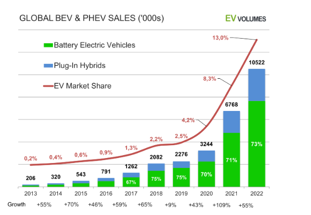
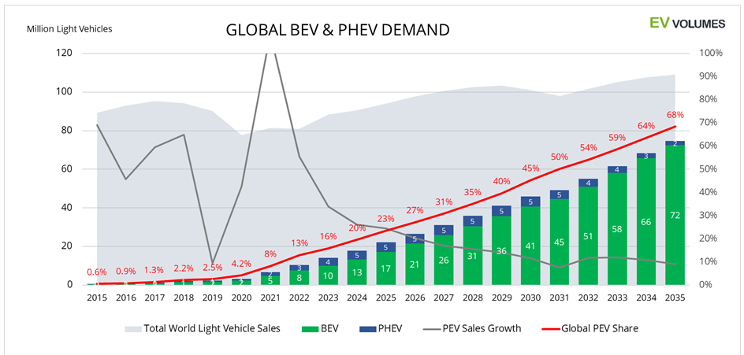
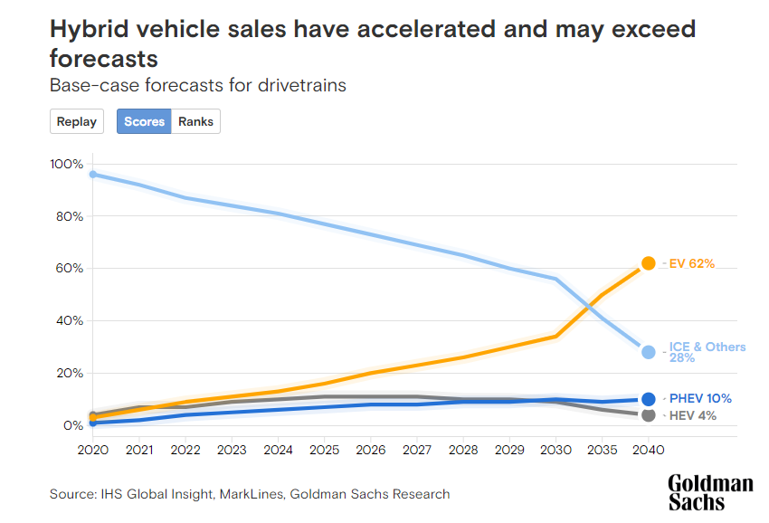
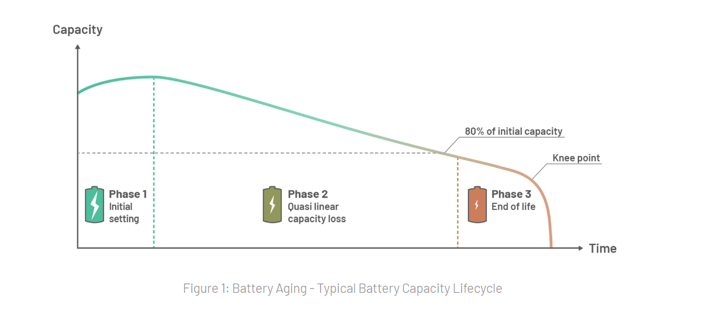
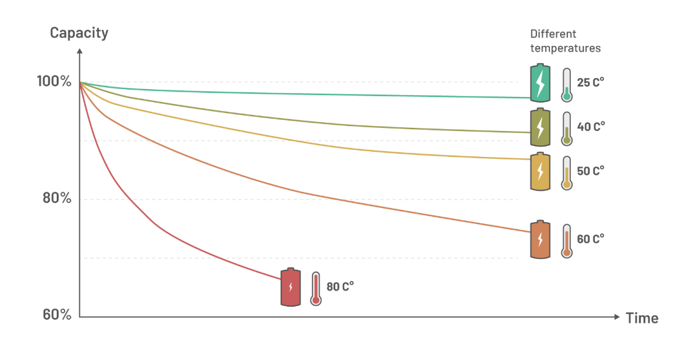
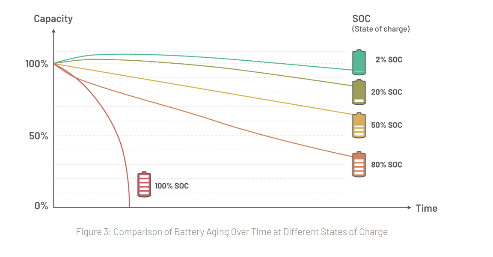
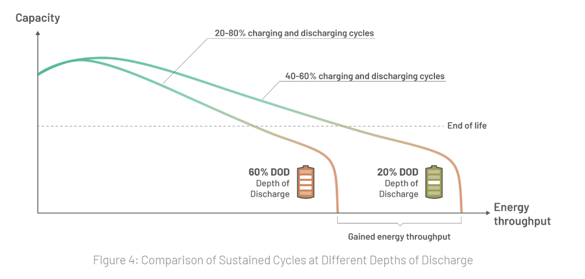
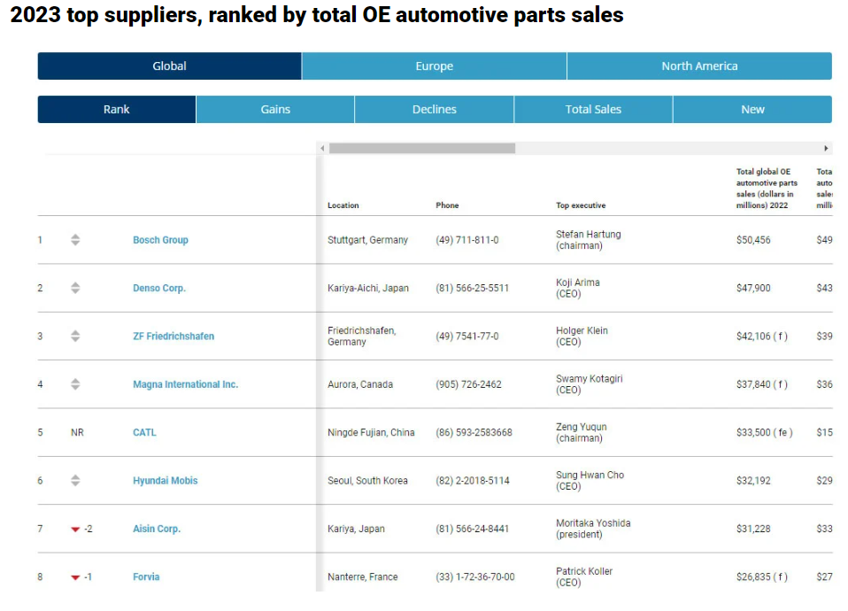
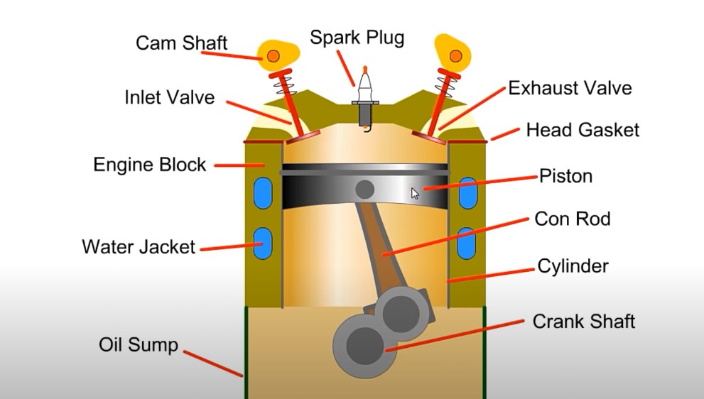
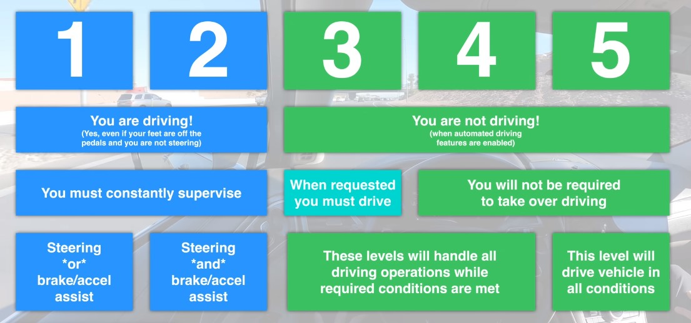

#+TITLE: Articles on automotive technology and market trends
#+FILETAGS: :Engineering:Automotive:
#+STARTUP: show2levels inlineimages hideallblocks

* EV market trends                                                   :Review:
:PROPERTIES:
:ID:       1f2c0984-0b3d-49f9-804b-35d5df1e011f
:END:

** Global EV sales

All numbers are in millions of units.

|-------------+-------+--------+-----+-----+-------+-----+----------|
| Market/year | China | Europe | USA | RoW | Total | AGR | AGR (US) |
|-------------+-------+--------+-----+-----+-------+-----+----------|
|        2025 |  13.0 |    4.2 | 1.5 | 2.0 |  20.7 | 22% |      -6% |
|        2024 |  11.0 |    3.1 | 1.6 | 1.3 |  17.0 | 23% |      14% |
|        2023 |   8.1 |    3.3 | 1.4 | 1.0 |  13.8 | 31% |      40% |
|        2022 |       |        | 1.0 |     |  10.5 |     |          |
|-------------+-------+--------+-----+-----+-------+-----+----------|
#+TBLFM: @2$7..@4$7=100*($6-@+1$6)/@+1$6;%.0f%%::@2$8..@4$8=100*($4-@+1$4)/@+1$4;%.0f%%

Source: [[https://www.iea.org/data-and-statistics/charts/electric-car-registrations-and-sales-share-in-china-united-states-and-europe-2018-2023][IEA outlook]]

Note that the numbers above are for EVs. That category includes BEVs
and PHEVs.

In 2024, S&P Mobility predicted that US BEV sales will only be at 5M
units in 2030, down from a previous projection of 6.5M. This means
that BEVs will account for 30% of a total US auto sales of about 16M.

** EV Volumes 2023
:PROPERTIES:
:CUSTOM_ID: EV_Volumes_2023
:END:

Source: EV Volumes forecast in 2023

** Goldman Sachs report June 2024

This [[https://www.goldmansachs.com/intelligence/pages/why-are-ev-sales-slowing.html][report]] argues that the bear case for EVs is more likely. The bear
case is that BEVs will account for 25M (25% of world-wide market)
in 2030. The hyper-adoption case was that EVs would account for 45M
(45% of world-wide market) in 2030.

Roughly 10M EVs were sold in 2022. So, this is a CAGR of 12% up
to 2030. The CAGR for the hyper-adoption case is 21%.

* EV batteries                                                       :Review:

** [[https://ihsmarkit.com/topic/IEBAutoTech.html#video-9-container][Battery technology trends]] - Youmin Rong, IHS Markit

  [[file:research/Screenshot 2022-03-04 144459.jpg][Automotive market]] is dominant for lithium ion batteries.

  Important factors for batteries are [[file:research/Screenshot 2022-03-05 141417.jpg][energy density]], power density, life span, cost and
  safety.

  The aim is to reduce cobalt usage in battery cathodes. [[file:research/Screenshot 2022-03-05 141932.jpg][Nickel]] is used
  quite a bit.

  The next generation technology is solid state. [[file:research/Screenshot 2022-03-05 142245.jpg][Lithium metal anode]] may
  still be required though for high energy density. However, you lose
  the lithium metal during discharge and get it back during charging.

  The advantages of solid state are higher energy density and improved
  safety because there is no flammable liquid. However, the lithium metal may
  increase costs.

  Various OEMs have different strategies for [[file:research/Screenshot 2022-03-05 142658.jpg][energy density]]. Lithium
  metal anodes have the highest energy density (350-500 Wh/kg) while
  Gr/Si anodes have 250-300 Wh/kg.

  Status of some solid-state [[file:research/Screenshot 2022-03-05 143119.jpg][battery startups]].

  [[file:research/Screenshot 2022-03-05 143328.jpg][Integrations]] and coalitions.

  Toyota is the world leader in patents on solid-state batteries.

** Lithium carbonate

Lithium carbonate is the main ingredient in lithium ion
batteries. The demand for this chemical is expected to go up from
600k tons on 2022 to 2.4M tons in 2030.

Australia is the largest supplier with about 40% of the market. The
triangle of Chile, Argentina and Bolivia have 66% of the world's
lithium resources but have struggled to mine it properly.

Source: Economist article in Nov 2022

** Lithium recycling

There is a need to regenerate lithium and rare metals from batteries
through recycling. The [[https://youtu.be/xLr0GStrnwQ][former CTO of Tesla]] has started a startup,
Redwood Materials, aimed at this.

** EV range and cold weather performance

In cold weather, ICE engines recirculate the heat radiated by the
engines into the cabin to warm it up. In contrast, EV batteries are
efficient and do not radiate as much heat. So, the cabin has to be
heated up using EV battery energy. As a result, EV range drops
significantly in winter conditions.

Per [[https://electrek.co/2022/12/13/worried-about-winter-range-loss-see-how-over-a-dozen-evs-compare/][this article,]] most EVs lose 15-20% range at 30 deg F compared to
70 deg F.

Recurrent did an in-depth study of real-life range from EVs. It showed
that, in real life, the Tesla Model S provides 90% of its EPA range
at 90 deg F but only 50% of its EPA range at 30 deg F. However, the
estimated range on the dashboard remains relatively constant at 90%
of the EPA range at these temperatures. Thus, Tesla owners are
promised a much higher range on the dashboard than they actually
get.

Other vehicle brands also show a variation in real-life range with
temperature but none are as drastic as the Tesla.

The article cautions, though, that newer Tesla models have heating
pumps and advanced thermal management that may reduce this
variation.

** Cell types and counts

  [[https://www.laserax.com/blog/ev-battery-cell-types][Pouch battery formats]] are most common in EVs. In this format, there
  are 100s of cells in an EV.

  The [[file:c:/Users/dwarr/Documents/GitHub/private/Battery_management_systems/Notes.org][Nissan Leaf]] has 48 2s2p battery modules = 192 cells for 24
  kWh. The Nissan Leaf e+ has 62 kWh and a configurable number of
  cells per module. However, it's not clear how many modules are in a
  pack. See [[https://www.nissan-global.com/EN/INNOVATION/TECHNOLOGY/ARCHIVE/LI_ION_EV/#:~:text=In%20the%20second%20generation%20LEAF,as%20standard%2C%20increasing%20filling%20efficiency.][Nissan page]].

  [[https://media.chevrolet.com/media/us/en/chevrolet/2022-bolt-euv-bolt-ev.detail.html/content/Pages/news/us/en/2021/feb/0214-boltev-bolteuv-specifications.html][Chevy Bolt]] EV and EUV have roughly 300 cells for 65 kWh.

  [[https://electricvehiclesfaqs.com/how-many-batteries-are-in-a-tesla-electric-car/#:~:text=The%20Tesla%20Model%203%20standard,groups%20(bricks)%20of%2031.][Tesla]] battery packs have 1000s of cells.

** Battery aging

  [[https://www.accure.net/battery-knowledge/blog-battery-aging][Accure]]

  

  Aging is caused by SEI (Surface Electrolyte Interface)
  formation. This forms on the graphite anode and accumulates over
  time, resulting in increased resistance.

  Biggest causes of accelerated aging are:
  - Temperature
    

  - High SoC
    

  - Number of cycles and average depth of discharge per cycle -> high
    average SoC -> aging
    

  - Fast charging -> increased temperature -> aging
   [[https://youtu.be/qYJk1Qljwgg?si=8TyrNCS7DSL9FN-5][Engineering Explained video]]

** Battery costs

The average BEV capacity will increase to roughly 70 kWh by 2030. The
costs for Lithium Ferrous Phosphate (LFP)  battery technology will drop
from $170/kWh in 2020 to $110/kWh in 2030.

** EV fires

According to [[https://spectrum.ieee.org/lithium-ion-battery-fires][IEEE Spectrum]], fires in batteries in EVs have a lower incidence rate
than fires in vehicles in general.

* Automotive Tier-1 suppliers

[[https://www.autonews.com/live-blog/2023-top-auto-suppliers-giants-grow-new-era][In 2023]], Bosch was the largest Automotive Tier-1 with an annual revenue of $50B.

* Total car sales in the US

The total car sales (BEV, PHEV, ICE, etc.) in the US in CY23 is
estimated to be at about 15M. This is down from a high in CY19
(pre-pandemic) of about 17M.

* Picture of automotive engine

  

* Autonomous driving levels

  

* References

[[https://drive.google.com/file/d/13eYJbFfhuhuLLr7BQ0xGqkOMnjDv42LM/view?usp=drivesdk][IHS Markit report]] on battery costs
[[https://www.recurrentauto.com/news/real-world-range-for-tesla][Recurrent study of real world range for Teslas]]

* Tasks

** TODO Read [[https://www.iea.org/reports/global-ev-outlook-2024][global EV outlook annual report]] and update [[id:1f2c0984-0b3d-49f9-804b-35d5df1e011f][EV market trends]] :Learning:
SCHEDULED: <2027-05-30 Sun +52w>
:PROPERTIES:
:EFFORT:  01:00
:BENEFIT: 10
:RATIO: 0.40
:LAST_REPEAT: [2026-06-13 Sat 08:21]
:PRIORITY_NUM: 2
:VALUE:    -90.00
:END:
- State "DONE"       from "TODO"       [2026-06-13 Sat 08:21]
:LOGBOOK:
CLOCK: [2025-06-08 Sun 08:28]--[2025-06-08 Sun 10:07] =>  1:39
:END:
