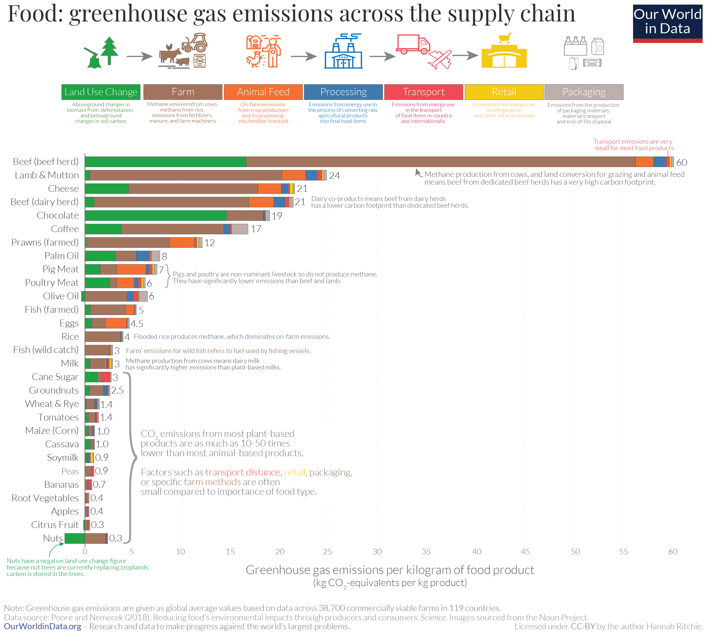
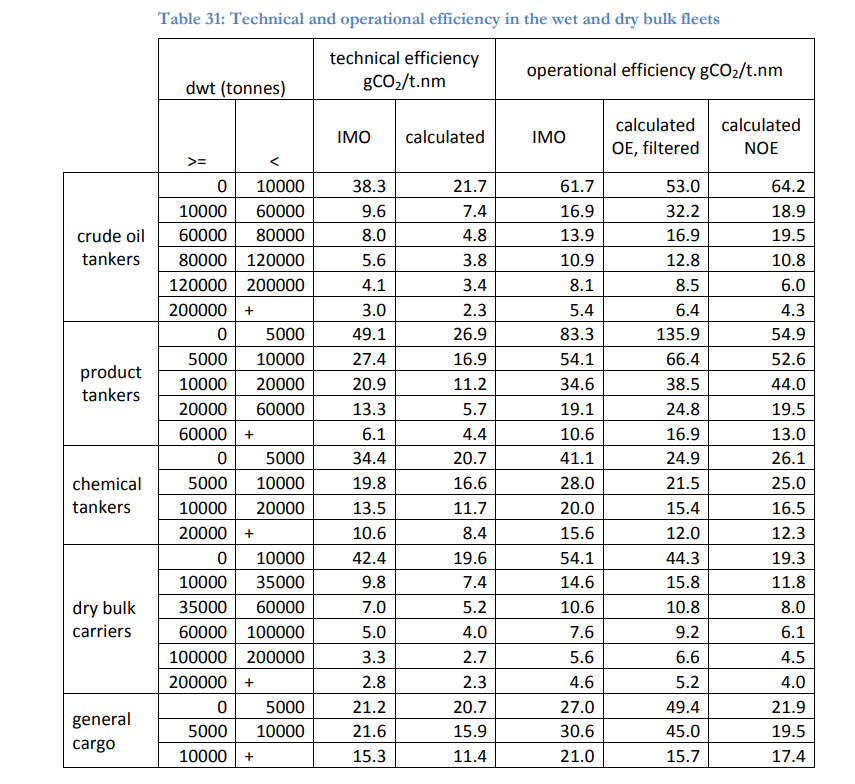
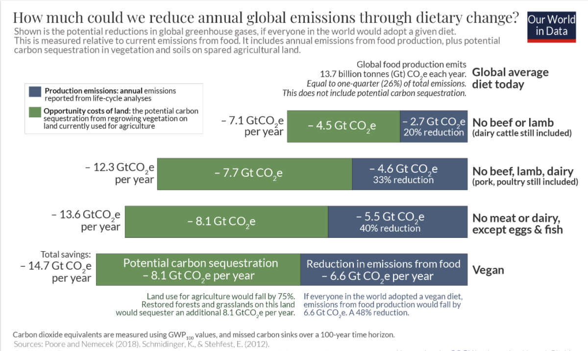

#+title: Calculation of carbon footprints
#+STARTUP: show2levels inlineimages hideallblocks
#+FILETAGS: :Engineering:

* Metrics for greenhouse gas emissions

The focus of greenhouse gas emission calculations tends to be on carbon dioxide
(CO2) emissions. However, other gases such as methane (CH4) and nitrous
oxide (N2O) also contribute to global warming. Hence, a better measure is
CO2 equivalent (CO2eq) where the emissions of the other gases are converted to
the CO2 scale. To calculate the equivalent values, you have to
consider the 100-year global warming potential of each gas.

* Average US CO2eq consumption                                       :Review:

In 2024, the average US resident consumes 18 T (tonnes) of CO2eq emissions per
year. This number is down significantly from about 25 T per year in
the early 2000s.

Out of the 18 T of emissions, about 10 T are discretionary choices by
the individual while about 8 T are 8 T are infrastructure emissions.

Broadly, 6 T of emissions are from industry (manufacturing,
construction materials, etc.), 6 T from transportation (aviation,
automotive, commercial, etc.), 4 T from residential and commercial
energy (heating and cooling), and 2 T from agriculture.

Land-use change and forestry can have negative impact on emissions.

Source: [[https://ourworldindata.org/profile/co2/united-states#how-much-does-the-average-person-in-the-united-states-emit-where-do-emissions-come-from][Our World In Data]]

* CO2eq emissions and GDP                                            :Review:

CO2eq emissions are used to drive industries, manufacturing, data
centers, etc. which in turn drive economic growth. It is important to
look at how much GDP growth a country has achieved and compare it with
CO2 eq emissions.

In the US, GDP per capita in 2000 (scaled to 2017 $ for comparison)
per ton of CO2eq emission was about $2000. The same number in 2025 was
$4000, implying a 50% improvement.

These improvements have resulted from the economy moving away from
manufacturing towards services, energy production moving from coal-based
to natural gas-based generation, and improved transportation fleets
and commercial energy use.

* CO2 emissions due to driving                                       :Review:

The following data on CO2 emissions due to delivered power and gas
consumption is from the [[https://www.epa.gov/energy/greenhouse-gases-equivalencies-calculator-calculations-and-references][EPA website]].

#+BEGIN_SRC python :results output
# Kg of CO2 per gallon of gas consumed
f1 = 8.9

# The Toyota RAV4 hybrid efficiency in gallons/mile
f2 = 1/40

# Assume 10,000 miles/year
f5 = 10**4

print("1 year in the RAV4 hybrid causes %.1f tons of CO2" % (f1*f2*f5/1000))

# Kg of CO2 per kWatt-hr of power delivered
f3 = 950*(4/9)*(1/1000)*(1/(1 - 0.073))

# The Toyota RAV4 Prime's battery efficiency in kWatt-hours/mile
f4 = 18/48

print("1 year of battery only in the RAV4 Prime causes %.1f tons of CO2" % (f3*f4*f5/1000))

#+END_SRC

#+RESULTS:
: 1 year in the RAV4 hybrid causes 2.2 tons of CO2
: 1 year of battery only in the RAV4 Prime causes 1.7 tons of CO2

* CO2 emissions from flights                                         :Review:

From [[https://ourworldindata.org/travel-carbon-footprint][Our World in data]],

#+NAME: flight_table
|--------------------------+---------------------|
| Type of flight           | Grams of CO2 per km |
|--------------------------+---------------------|
| Domestic short-haul      |                 255 |
| International (economy)  |                 150 |
| International (business) |                 434 |
|--------------------------+---------------------|

#+BEGIN_SRC python :results output :var tab = flight_table
  # Assume a certain distance in miles flown per year
  # One-way distance from Boston to San Francisco is 3000 miles
  # One-way distance from Boston to Chennai is 8000 miles
  miles_per_year = [6000, 16000]

  total_CO2 = 0
  for f_type in range(len(miles_per_year)):
     # Convert table data from km to miles
     total_CO2 = total_CO2 + miles_per_year[f_type] * tab[f_type+1][1] * 1.6

  print("Flying causes %.1f tons of CO2 per year" % (total_CO2/(1e6)))
#+END_SRC

#+RESULTS:
: Flying causes 6.3 tons of CO2 per year

* Contribution of various stages of food production                  :Review:

Food production accounts for 25% of GHG emissions (CO2, CH4 and
N2O). Within food production, land use change (converting grasslands
to agricultural land) and farm-stage processes (fertilizer
application and methane generated in the bellies of cows) account
for a majority of GHG emission. All stages after the farm account
for 10% or less (see ). So, "eating local" doesn't help
with GHGs. Removing meat and milk-based products as seen in
[[Plant-based diets]] does help.

The only exception is that you shouldn't eat
air-freighted foods: those tend to be foods that need to stay fresh
and come from a far distance. However, it is hard to know which ones
those are and they tend to be rare.

* CO2 emissions from container shipping                              :Review:

From a [[https://theicct.org/sites/default/files/publications/UCL_ship_efficiency_forICCT_2013.pdf][report published by the University College of London]], the
following table shows CO2 emissions from various kinds of container
ships. The Normalized Operational Efficiency (NOE) may be the
appropriate metric to use.

* Plant-based diets                                                  :Review:

From [[https://ourworldindata.org/carbon-opportunity-costs-food][Our World in Data]], plant-based diets have the best properties
of opportunity cost (saved agricultural land can be converted into
forests to act as carbon sinks) and GHG reductions. However,
removing meat and milk from the diet (keeping eggs and fish) gets
you most of the improvements.

Plant-based diets are better than meat-based diets even when you
[[https://ourworldindata.org/less-meat-or-sustainable-meat?country=][normalize for protein production]].

* Tasks

** TODO [#E] Calculate the carbon and water footprint for my house :Learning:
:PROPERTIES:
:EFFORT:  01:00
:BENEFIT: 40
:RATIO: 0.40
:VALUE:    -60.00
:PRIORITY_NUM: 1
:END:
