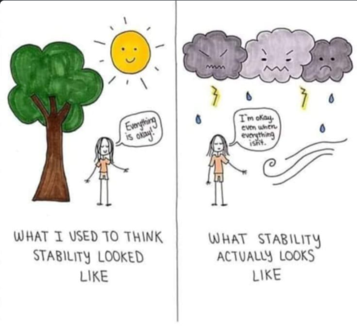

#+TITLE: The science of happiness and well-being
#+FILETAGS: :Philosophy:
#+STARTUP: show2levels inlineimages hideallblocks

* Subjective Well-Being or Happiness                                 :Review:
:PROPERTIES:
:ID:       20490abc-0f84-4536-aeb1-e9a37bea6812
:END:

Ed Diener pioneered the concept of Subjective Well-Being (SWB). He
suggests that SWB consists of two components, Affective Balance and
Life Satisfaction. The SWB score is the sum of the two scores.

#+BEGIN_SRC python :results file graphics :exports results :file autogen_SWB.png :eval yes
  import matplotlib.pyplot as plt
  import networkx as nx
  import os

  # Create the graph
  G = nx.Graph()
  G.add_edge("Subjective Well-Being", "Affective Balance")
  G.add_edge("Subjective Well-Being", "Life Satisfaction")

  G.add_edge("Affective Balance", "Positive emotions")
  G.add_edge("Affective Balance", "Negative emotions")

  G.add_edge("Life Satisfaction", "Self")
  G.add_edge("Life Satisfaction", "Work")
  G.add_edge("Life Satisfaction", "Social connections")

  G.add_edge("Self", "Health")
  G.add_edge("Self", "Wealth")
  G.add_edge("Self", "Wisdom")
  G.add_edge("Self", "Leisure")

  G.add_edge("Work", "Autonomy")
  G.add_edge("Work", "Mastery")
  G.add_edge("Work", "Purpose")

  # Define a manual hierarchical layout
  pos = {
      "Subjective Well-Being": (0, 2),   # root, top center

      "Affective Balance": (-1, 1),      # left branch
      "Life Satisfaction": (1, 1),       # right branch

      "Positive emotions": (-1.5, 0),
      "Negative emotions": (-0.5, 0),

      "Self": (0.5, 0),
      "Work": (1.5, 0),
      "Social connections": (2.5, 0),

      "Health": (0, -1),
      "Wealth": (0.5, -1),
      "Wisdom": (1.0, -1),
      "Leisure": (1.5, -1),

      "Autonomy": (1.0, -2),
      "Mastery": (1.5, -2),
      "Purpose": (2.0, -2),
  }

  # Helper to wrap labels nicely
  def wrap_label(label, max_words=1):
      words = label.split()
      return "\n".join(
          [" ".join(words[i:i+max_words]) for i in range(0, len(words), max_words)]
      )

  # Create wrapped labels for all nodes
  labels = {node: wrap_label(node, max_words=1) for node in G.nodes()}

  # Draw the graph with wrapped labels
  nx.draw(
      G, pos,
      labels=labels,
      with_labels=True,
      node_color="lightblue",
      node_size=3500,   # enough space for multiline text
      font_size=9
  )

  # Save and return the path to Org Babel
  filename = "autogen_SWB.png"
  plt.savefig(filename)
  plt.close()
#+END_SRC

#+RESULTS[d75e0ece5234fa7ec34db4b0dd73a37bfafa7d65]:
[[file:autogen_SWB.png]]

** Affective Balance

Affective balance is the difference between positive affects or
feelings and negative affects. This is a measure of the moods of a
person and is emotional in nature. An example measure for Affective
Balance is the [[https://en.wikipedia.org/wiki/Positive_and_Negative_Affect_Schedule][Positive and Negative Affect Schedule]] (PANAS).

The brain has a negativity bias. We feel the loss of something more
sharply than the gain of an equal amount. Also, negative feelings are
generated much faster through the amygdala than positive feelings.

You can't completely be rid of the negative feelings in the left
column below. In the short-term, you will be overcome by them but you
should always move towards the positive feelings on the right in the
long-term.

*** Table of feelings
:PROPERTIES:
:ID:       b18c66e0-1269-4b0f-90f0-35cd759852b2
:END:

|------------------+---------------------|
| Negative feeling | Positive equivalent |
|------------------+---------------------|
| Fear             | Courage             |
| Envy             | Satisfaction        |
| Regret           | Learning            |
| Greed            | Generosity          |
| Anger            | Equanimity          |
| Pride            | Humility            |
|------------------+---------------------|
| FERGAP           | CSLGEH              |
|------------------+---------------------|

*** Regret to Learning

Annie Duke in "Thinking in Bets" reminds us that, just because the
outcome of a decision turned out poorly, it does not follow that the
decision choice was poor. In fact, it may have been your best choice a
priori. Learn to make that distinction. True learning is when you
learn how to make better decisions based on a priori knowledge. Regret
is when you rue a decision based on an unfavorable outcome.

*** Pride to Humility

There are people in the world who are doing greater and better things
than you are. So, you can strive to be humble about whatever you have
accomplished.

At the same time, if you do not commit unethical or
illegal acts and if you have helped others, you have done more than
many people. So, you can be justifiably proud of such actions.

** Life Satisfaction
:PROPERTIES:
:ID:       3884f562-7a2e-4e3a-893e-20e9791ca16f
:END:

Life Satisfaction (LS) is the satisfaction with important life
domains - society, work, and self. This is a cognitive measure
i.e. it is how you would evaluate life if you stepped back to reflect
on it. LS is more long-term while Affective Balance can
show short-term fluctuations.

One of the most important influences on LS is social
relationships. People who score high on LS tend to have close and
supportive family and friends, whereas those who do not have close
friends and family are more likely to be dissatisfied.

Another factor is work or, more generally, performance in an important
role such as homemaker or grandparent. When the person enjoys their
work, and feels that it is meaningful and important, it increases
their LS. When work is going poorly because of bad external
circumstances or a poor fit with the person’s strengths, this can
lower LS.

Human beings generally feel pleasure from working towards a goal. The
goal has to be challenging but achievable and they should get regular
feedback. This allows them to achieve a state of flow. However, even
though they think there is pleasure to be gained when they achieve a
goal, they do not actually gain any long-term pleasure. Eg. winning a
lottery, getting your ideal job, etc. The actual pleasure is in
working towards the goal and making progress. This is analogous to the
movie "Memento" where the protagonist continually sets new goals to
challenge himself.

A third factor that influences the LS of most people is
personal – satisfaction with the self, religious or spiritual life,
learning and growth, and leisure. For many people, these are sources of
satisfaction. However, when these sources of personal worth are
frustrated, they can be powerful sources of dissatisfaction.

There could be additional sources of satisfaction and dissatisfaction
– common sources such as health and other sources that
are unique to each individual. Most people know the factors that lead
to their satisfaction or dissatisfaction, although a person’s
temperament – a general tendency to be happy or unhappy – can color
their responses. This temperament is highly correlated with genes.

There is no single key to LS. However, a dissatisfied
person can increase their LS with time and effort. For
instance, people who suffer a loss recover over time. People who have
dissatisfaction in any one domain often make changes over time that
will increase their satisfaction. If a person is chronically
dissatisfied, they should look within themselves and develop more
positive attitudes to life and the world.

Buddha said that happiness comes from within. It cannot be achieved by
making the outside world conform to your wishes. Modern positive
psychology agrees.

All of this is nicely captured in this cartoon.

* The Stoic philosophy                                               :Review:
:PROPERTIES:
:ID:       f3c5151b-e88c-42f8-837b-a7794d2ba35b
:END:

** Negative visualization

We have been programmed by evolution to think about how much better
our lives could be, how much more money we could have, etc.

Instead, we should think about how much worse our life could be - we
could be very sick, we could not have functioning minds, we could be
starving, we could lose our loved ones, etc.

By constantly reminding ourselves of how good we have it compared to
all that, we can overcome the greed of wanting more.

Further, by constantly thinking through these scenarios, we can
insulate ourselves if such crises were to materialize.

** Goal internalization

There are many goals we want to achieve that are partly outside of
control eg. winning a tennis match. So, set your goal to be internal
eg. I'll play the best tennis game I can right now. Don't set the goal
to be what you don't have control over.

If you're not successful with the goal, learn what you can do better
next time ie. What's within your control. Then, let go of what is now
in the past ie. I lost the last tennis game.

** Seeking fame

The Stoics advise that we stay away from seeking fame. If we want
other people to like us or worship us, we must behave in ways that
they see fit. In doing so, though, you give up control of what
fulfills you.

Making someone else feel good about you is a goal that you have
limited control over. Internalizing that goal means that you should do
the things that feel right for you and not worry about what others
think of it.

** Seeking wealth

Why do we need wealth? We are such small bodies and we need so
little. Simple food, simple clothes and a simple house that protects
us from the elements. Why do we need any more?

Even if we practise luxurious living, our hedonistic adaptation will
lead us to want more. So it's best to program ourselves to want less.

Contrary to usual beliefs, it may be easier to practise self-denial
than not to. It takes time and money to be a connoisseur, to want high
quality things, and to indulge in luxuries. It is a lot simpler to
forego these and find delight in what we already have.

** Contemplating death

The Stoics recommend spending time contemplating your death. This
forces you to think about what goals you want to achieve before you
die. Those goals should be internalized so that they're within your
control.

Many Stoics died because they stood up against authority for values
that they cared about. Others in their place would have given up those
values to continue living. However, if there is nothing in your life
worth dying for, is there anything in your life worth living for?

** Fighting your other half

There will be one half of you, the impulsive one, that generates
feelings of anger, pride, fear, etc. Make it a game between your
reflective Stoic half and the impuslive half. The Stoic half fights
the impulsive half by acts of self-denial, embracing discomfort, being
satisfied with internal goals, etc. Think of your external competitors
or detractors as partners in your internal fight against your
impulsive self. By giving you opportunities to exercise
self-restraint, to go outside your comfort zone etc., they are helping
your Stoic self in the battle.

** Start now

It is best to start the Stoic practice in small pieces now.

Start by taking delight in life as you have it right now.

Remember that anything you have can be taken away from you by
chance. Visualize that possibility.

Practise self-denial.

Push yourselves into areas of discomfort to prepare for potential
adversity in the future.

* A Buddhist take on happiness                                       :Review:

We look for happiness outside ourselves when it is basically an inner
state of being.

The essential thing is to identify the types of mental activity that
lead to well being and those that lead to suffering, even when the
latter afford us brief instances of pleasure.

Systematically blaming others and holding them responsible for our
suffering is the surest way to lead an unhappy life.

Recognize your aspiration for happiness, then extend that aspiration
to those you love and finally to your friends, strangers and even your
enemies. Little by little, altruism and benevolence will saturate your
mind, until it becomes second nature.

Boredom is the fate of those who rely entirely on distraction, for
whom life is one big entertainment.

See also [[id:f3c5151b-e88c-42f8-837b-a7794d2ba35b][The source of true happiness]].

* Measurements of quality of life                                    :Review:

A commonly used quantitative measurement of life is [[https://en.wikipedia.org/wiki/Quality-adjusted_life_year][Quality-adjusted
life year]] or QALY. A QALY measure of 1.0 means a year of perfect
health while values below that mean less than perfect health or
quality of life. A value of 0 represents death. Different
interventions can be measured by summing up the resulting measures
over the number of years of life that they provide.

[[https://www.wsj.com/articles/obscure-model-puts-a-price-on-good-healthand-drives-down-drug-costs-11572885123][This article]] talks about the use of QALYs by a research
organization called ICER in the US and how it could reduce drug
prices. While other countries have adopted QALY as a measure, the
US has not yet.

From the [[ https://www.wsj.com/articles/obscure-model-puts-a-price-on-good-healthand-drives-down-drug-costs-11572885123][WSJ article]], ICER puts the cost of one QALY in the US at
$150,000. A graph of QALYs used by other countries is in the
article. The approach of using QALYs was first established in the
UK.

** Quotes                                                            :quotes:

*** Seneca: The day you become superior to pleasure, you also become superior to pain

*** John Donne: No man is an island, entire of itself; ...therefore never send to know for whom the bells tolls; it tolls for thee.

*** King Crimson: I'm happy with what I have to be happy with.

*** Matthieu Ricard: What do you need to accomplish or what do you need to discard in order to achieve well-being and live a meaningful life?

*** Matthieu Ricard: Why don't we devote even the briefest of moments once a day to introspection?

** References

- Jonathan Haidt, "The Happiness Hypothesis"
- Edward Diener and Robert Biswas-Diener, "Happiness"
- Sonja Lyubomirsky, The How of Happiness
- Matthieu Ricard, "Happiness"
- William Irvine, "A Guide to the Good Life"
